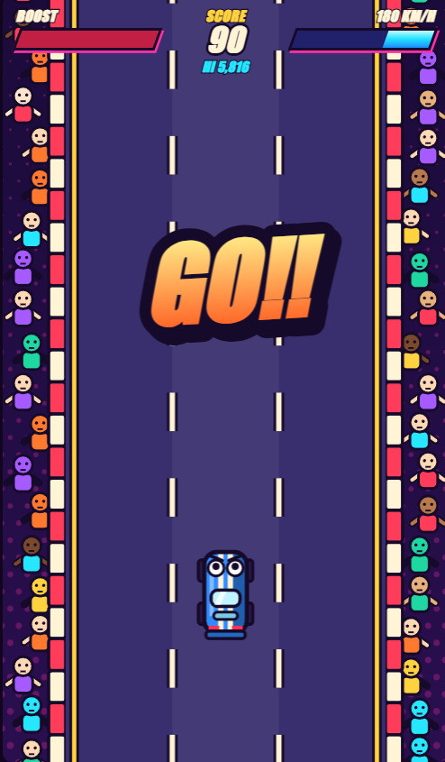

# Neon Racer

**A fast, cartoon-style arcade racer you can play in your browser or run with Python.**

Neon Racer is a three-lane endless highway game in a bold, fighting-game-inspired art style. Dodge traffic, grab boost pads, and build combos. The project ships in two versions that share the same rules and the same look:

- **Web version** (HTML + CSS + JavaScript): open one file, no install.
- **Python version** (pygame): a desktop build of the same game.



 

**Live demo:** `https://comelanggilesgiles.github.io/neon-racer/` (available after you enable GitHub Pages, see [Deploy](#deploy-to-github-pages-optional)).

---

## Key Features

- **Three-lane driving** with keyboard or tap controls.
- **Live traffic** that spawns by distance travelled, so higher speed means a busier road.
- **Boost pads** that raise your speed for about four seconds and pack the road with more cars, turning the race chaotic.
- **Dynamic speed** that slowly ramps up the longer you survive.
- **Speed-based scoring**: every frame adds your current speed to your score.
- **Dodge combos**: switch lanes just before a collision to start a hit combo and earn bonus points.
- **Cartoon animation**: thick outlines, squash and stretch, comic impact bursts, screen shake, hit-stop, a cheering crowd, and announcer banners (READY, GO, BOOST, K.O.).
- **Saved high score** (browser storage in the web version, a local file in the Python version).
- **No build step** and only one dependency (pygame) for the Python version.

---

## Quick Start (about 5 minutes)

### Web version

**Fastest way: download and play**

1. Click the green **Code** button on the GitHub page, then **Download ZIP**.
2. Unzip the folder.
3. Double-click `index.html`.

**With Git**

```bash
git clone https://github.com/Comelanggilesgiles/neon-racer.git
cd neon-racer
```

Open `index.html` in your browser:

- macOS: `open index.html`
- Linux: `xdg-open index.html`
- Windows: `start index.html`

**Optional local server** (if your browser blocks something when opening the file directly):

```bash
python3 -m http.server 8000
```

Then visit `http://localhost:8000`.

### Python version

You need Python 3.9 or newer.

```bash
git clone https://github.com/Comelanggilesgiles/neon-racer.git
cd neon-racer/python

# Optional but recommended: create a virtual environment
python3 -m venv .venv
source .venv/bin/activate        # Windows: .venv\Scripts\activate

pip install -r requirements.txt
python neon_racer.py
```

A game window opens. Press **Enter** to start.

---

## How to Play

| Action | Keyboard | Mouse / Touch |
| --- | --- | --- |
| Move one lane left | Left Arrow or `A` | Click or tap the left half |
| Move one lane right | Right Arrow or `D` | Click or tap the right half |
| Start or rematch | `Enter` or `Space` | Click or tap the button |
| Quit (Python version) | `Esc` | Close the window |

Tips:

- Switching lanes at the last second, just as a car is about to hit you, counts as a **dodge** and builds your combo.
- Boost pads (yellow, with chevrons) give a big speed jump. They score more, but the road gets crowded.
- Crashing ends the round with a **K.O.**

---

## How It Works (Learn the Code)

Both versions follow the same small set of rules. If you are learning game programming, read them in this order.

**1. Lane switching.** The player is always in lane 0, 1, or 2. Boundary checks keep the car on the road.

Python:
```python
if d < 0 and self.lane > 0:
    self.lane -= 1
if d > 0 and self.lane < 2:
    self.lane += 1
```

JavaScript:
```js
if (d < 0 && lane > 0) lane -= 1;
if (d > 0 && lane < 2) lane += 1;
```

**2. Traffic behavior.** Every frame, each car moves down the screen at the current speed:

```python
for car in self.traffic:
    car["y"] += self.speed
```

Because traffic uses the same `speed` value as everything else, going faster makes obstacles arrive sooner.

**3. Dynamic speed.** `speed` starts at 6. The base speed creeps up to 8 over time and eases back toward it after a boost ends.

**4. Boost activation.** When the player rectangle overlaps a boost pad, the game sets `boost = True` and raises `speed` by 3. A timer switches boost off after about four seconds. While boosted, traffic spawns more often, which is what makes the race chaotic.

**5. Scoring.** Each frame adds the whole-number part of the current speed:

```python
self.score += int(self.speed)
```

**6. Game loop.** A fixed 60-updates-per-second loop runs the game rules and then draws the frame. A short "hit-stop" freeze on impacts makes hits feel heavier.

### Try changing something

| Search for | What it changes |
| --- | --- |
| `BOOST_FRAMES` | How long boost lasts |
| `base_speed` / `baseSpeed` | Starting and maximum normal speed |
| `spawn_dist` / `spawnDist` | How much traffic appears |
| `CAR_COLORS` | Traffic car colors |
| `PLAYER_Y` | Where your car sits on the screen |

Edit the file, save, and rerun (or refresh the browser) to see the result.

---

## Project Structure

```
neon-racer/
  index.html            Web version: page structure and menus
  css/
    style.css           Web version: HUD, menus, and cartoon text styling
  js/
    game.js             Web version: game logic, input, and canvas drawing
  python/
    neon_racer.py       Python version: the full game in pygame
    requirements.txt    Python dependencies
  docs/
    screenshot.png      Gameplay screenshot (add your own)
  .gitignore
  README.md
```

---

## Tech Stack

**Web version**
- HTML5 for page structure and overlays
- CSS3 for the HUD and menus (custom properties, flexbox)
- JavaScript (ES6) for game logic, input, and the main loop
- Canvas 2D API for all in-game drawing and animation
- Web Storage (`localStorage`) for the saved high score

**Python version**
- Python 3.9+
- pygame 2.5+ for windowing, input, and drawing

**Tooling**
- Git and GitHub for version control
- GitHub Pages for optional hosting of the web version

---

## Deploy to GitHub Pages (optional)

1. Push the project to GitHub.
2. Open your repository, then **Settings** and **Pages**.
3. Under **Build and deployment**, choose **Deploy from a branch**.
4. Select the `main` branch and the `/ (root)` folder, then click **Save**.
5. After a minute, the web version is live at `https://comelanggilesgiles.github.io/neon-racer/`.

---

## Contributing

Contributions are welcome, whether it is a bug fix, a new feature, or a documentation improvement.

1. **Fork** the repository using the Fork button on GitHub.
2. **Clone your fork:**
   ```bash
   git clone https://github.com/<your-username>/neon-racer.git
   cd neon-racer
   ```
3. **Create a branch** with a short, descriptive name:
   ```bash
   git checkout -b feature/sound-effects
   ```
4. **Make your changes.** Test the web version by opening `index.html`, and the Python version by running `python python/neon_racer.py`.
5. **Stage and commit** with a clear message:
   ```bash
   git add .
   git commit -m "Add sound effects for boost and crash"
   ```
6. **Push** your branch:
   ```bash
   git push origin feature/sound-effects
   ```
7. **Open a Pull Request** on GitHub. Describe what you changed and why. Add a screenshot or short clip for visual changes.

If you change a game rule (speed, scoring, boost), please update both versions so they stay consistent.

### Commit message guidelines

- Use the present tense and start with a verb: "Add", "Fix", "Update", "Remove".
- Keep the first line under 72 characters.
- Make one logical change per commit.

### Ideas for contributions

- Sound effects and music
- Extra traffic types (trucks, motorcycles)
- Day and night stages
- A pause menu
- Difficulty settings
- A shared online leaderboard

---

## Troubleshooting

| Problem | Fix |
| --- | --- |
| Web page is blank | Make sure you opened `index.html`, not the folder, and that `css/` and `js/` are next to it. Try the local server option. |
| Keys do not respond (web) | Click once on the game to give it focus, then try again. |
| `No module named pygame` | Activate your virtual environment, then run `pip install -r requirements.txt`. |
| Python window is too tall for the screen | The window is resizable. Drag its corner to make it smaller. |
| Text looks different in Python | The game uses the Impact font when available and falls back to Arial. This is cosmetic only. |
| High score is missing | Web: private browsing or cleared site data removes it. Python: it is saved in `python/highscore.txt`. |

---

## Author

Created by [Comelanggilesgiles](https://github.com/Comelanggilesgiles).

## License

No license has been chosen yet. To let others use and modify your work, add a `LICENSE` file (the MIT License is a common, permissive choice) and mention it here.
